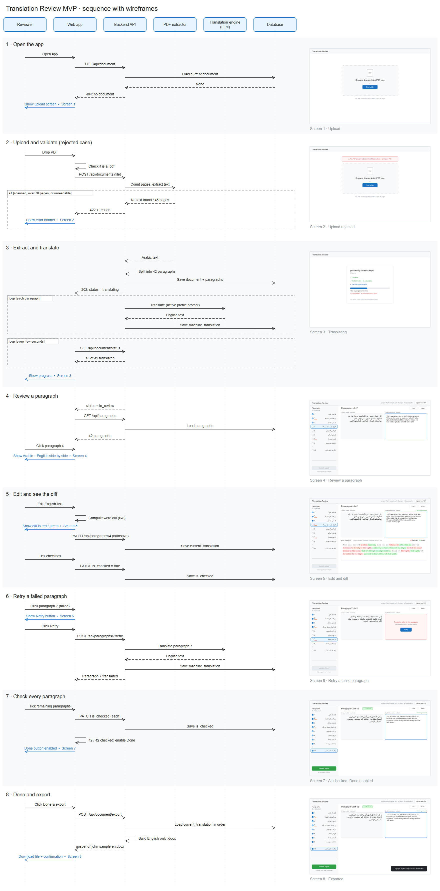
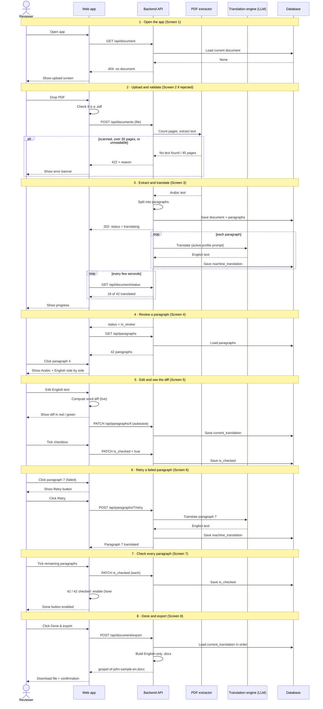
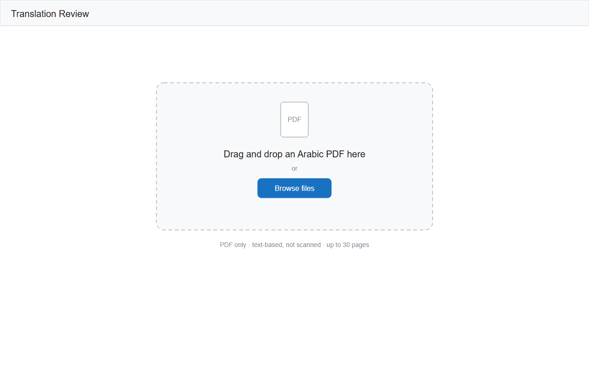
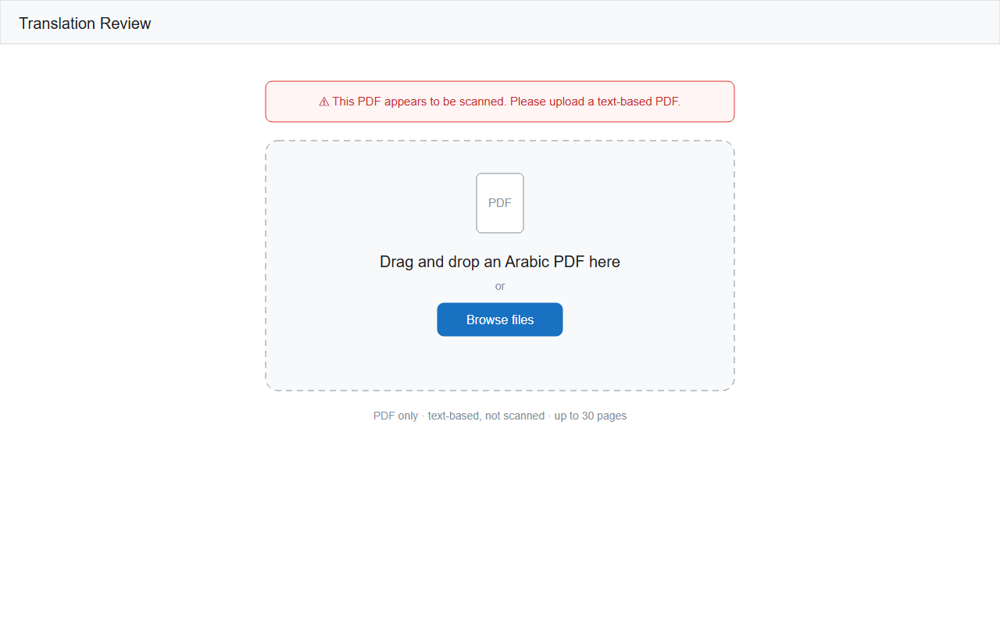
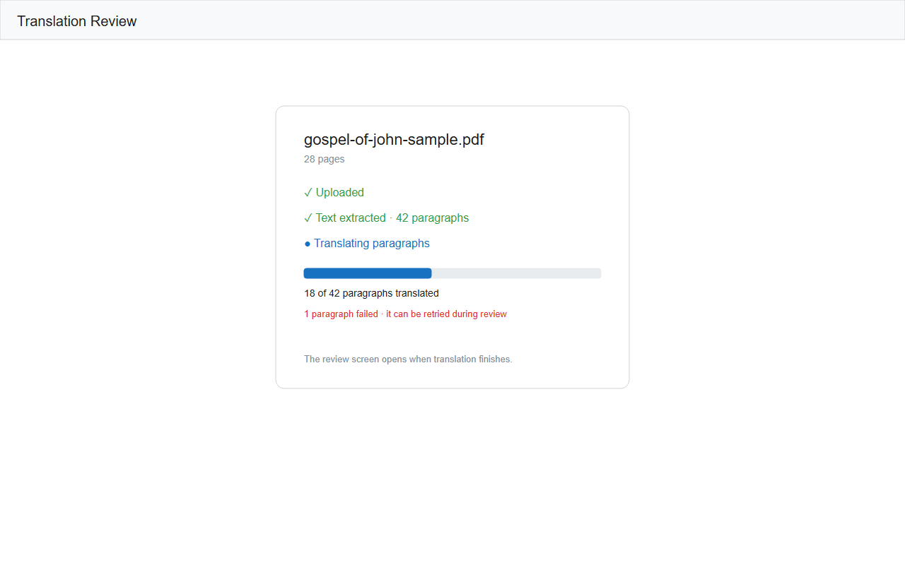
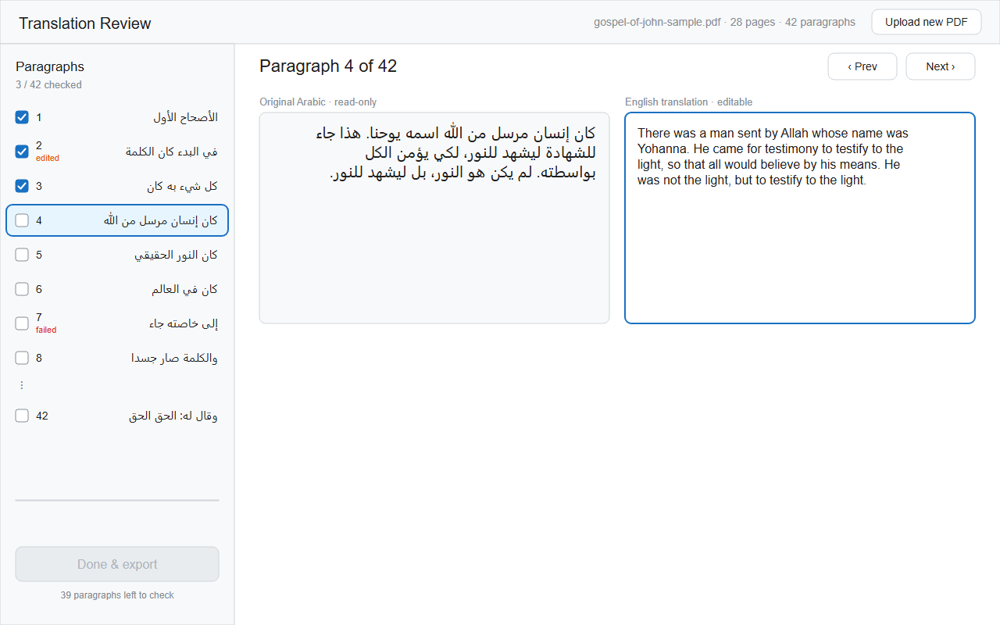
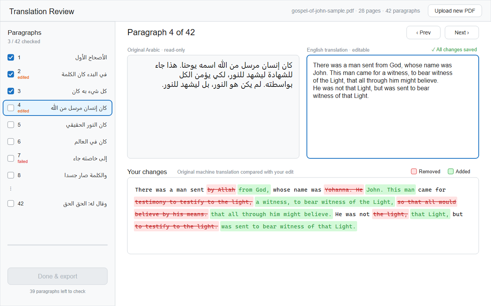
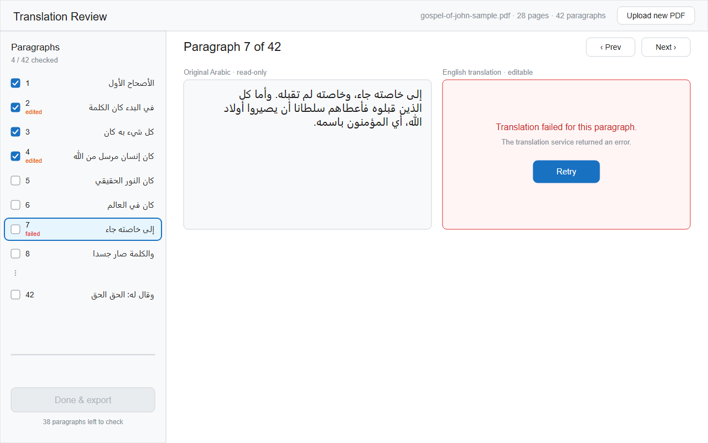
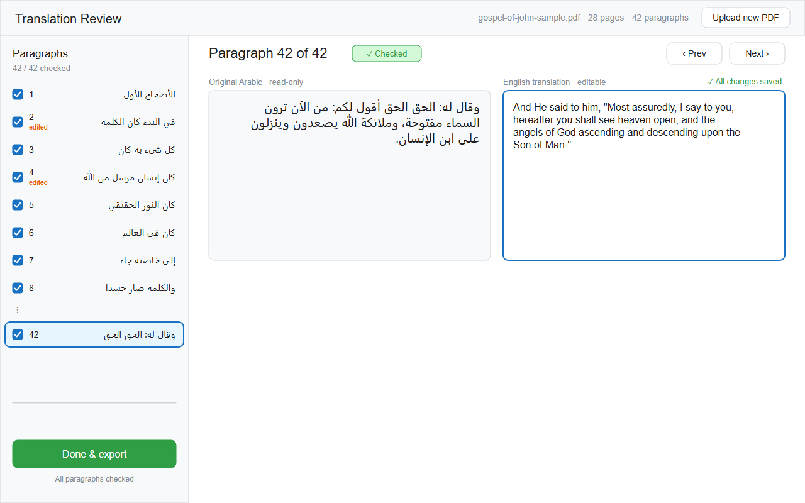
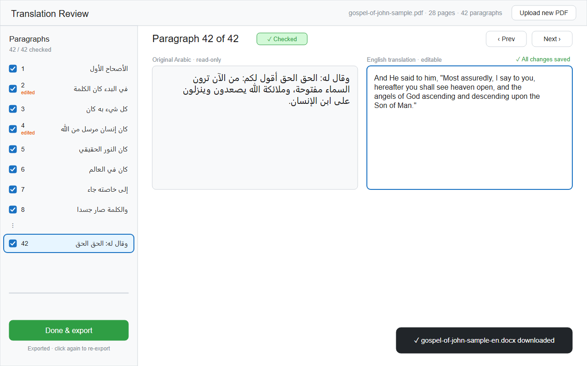

# Translation Review MVP: Sequence with Wireframes

Companion to [PRD.md](../PRD.md). Shows how the reviewer, the web app, and the backend services interact at each step, with the screen the reviewer sees at that point.

The tool works with any Arabic text. The wireframes use sample content only: the Gospel of John, chapter 1, translated with the Christian / Bible profile. The Arabic is from the Van Dyck Arabic Bible (public domain), and the reviewed English matches the NKJV (PRD TR-2b). With the General profile or another profile, the flow and screens are the same.

**Files in this folder**

| File | What it is |
| --- | --- |
| [sequence-diagram.excalidraw](sequence-diagram.excalidraw) | Full sequence diagram with every wireframe screenshot embedded beside its step |
| [sequence-diagram.png](sequence-diagram.png) | PNG export of the diagram above |
| [wireframes/](wireframes/) | One editable `.excalidraw` file per screen (01 to 08) |
| [screenshots/](screenshots/) | PNG of each wireframe |

Open `.excalidraw` files at [excalidraw.com](https://excalidraw.com) (File > Open) or with the Excalidraw VS Code extension. Opening a file locally does not upload it anywhere.

**Participants**

| Participant | Role |
| --- | --- |
| Reviewer | The single MVP user (uploads and reviews) |
| Web app | Browser front end: navigator, side-by-side view, live diff |
| Backend API | Validates uploads, coordinates extraction, translation, persistence, export |
| PDF extractor | Library that counts pages and extracts Arabic text |
| Translation engine (LLM) | Translates one paragraph at a time using the general rules plus the active translation profile (TR-2) |
| Database | Stores the document and paragraphs (see PRD data model) |

---

## Full sequence

The same flow as text (renders as a diagram on GitHub, or in VS Code with a Mermaid preview extension):

---

## Step by step

### 1 · Open the app
With no document in the database, the reviewer lands on the upload screen. The accepted input is spelled out under the drop zone (UP-1).

### 2 · Upload rejected
The browser checks the file type first. The backend then checks page count and text layer. A rejected file gets a specific reason (UP-2).

### 3 · Extract and translate
After a valid upload, the backend splits the text into paragraphs and translates them one by one. The web app polls for progress. A paragraph that fails to translate is counted but doesn't stop the rest (TR-4, TR-5).

### 4 · Review a paragraph
The navigator lists every paragraph with a checkbox, the first words of the Arabic, and an `edited` or `failed` tag. Clicking a row shows that paragraph side by side (RV-1, RV-2).

### 5 · Edit and see the diff
Typing in the English box updates a word-level diff against the original machine translation: removed words in red with strikethrough, added words in green. Changes autosave, and the navigator marks the paragraph as `edited` (RV-3, RV-4, DF-1 to DF-5).

### 6 · Retry a failed paragraph
A paragraph whose translation failed shows a Retry button in place of the English text. Retrying translates only that paragraph (TR-5).

### 7 · All checked, Done enabled
Done & export stays disabled until all 42 paragraphs are checked. Unticking any paragraph disables it again (EXP-1, CK-2).

### 8 · Exported
Clicking Done & export builds an English-only file in paragraph order and downloads it. Re-exporting is allowed (EXP-2 to EXP-4). The `.docx` format follows the PRD's current assumption and is still an open question.

